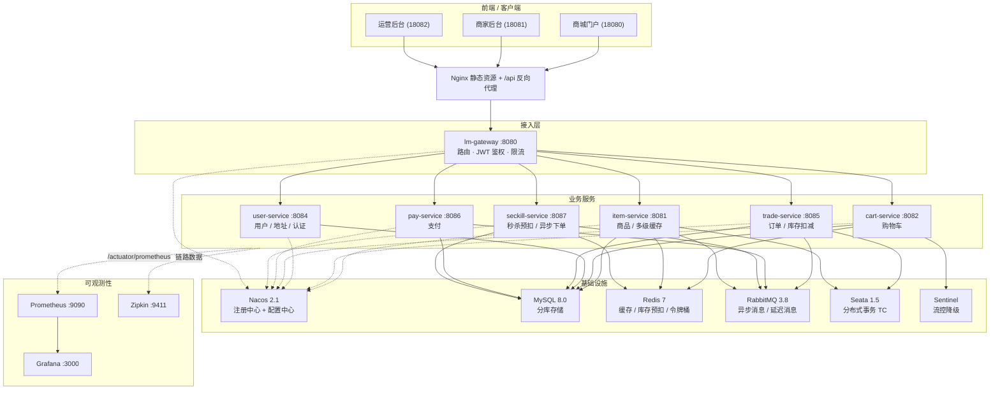

# 青柠商城 LimeMall

一个基于 **Spring Cloud Alibaba** 的电商微服务平台，覆盖商品、搜索、购物车、交易、支付、用户、**秒杀**七大业务域，
包含网关鉴权、服务注册发现、分布式事务、消息驱动、多级缓存、限流削峰、可观测性等完整的微服务工程实践。

> 项目从单体架构出发（`lm-shop` 模块保留了单体基线），逐步演进为按业务域拆分的微服务架构。

## 项目亮点（数据均来自真实压测）

| 亮点 | 实测结果 |
|---|---|
| **秒杀链路**：Redis+Lua 原子预扣 · 令牌桶限流 · MQ 异步削峰 · 一人一单 · 对账补偿 | 200 用户抢 100 件 → **恰好 100 单、零超卖**；吞吐 **105 TPS** vs 数据库悲观锁方案 43.5 TPS（**2.4 倍**），平均延迟下降 58% |
| **商品详情多级缓存**：Caffeine + Redis + 布隆过滤器 + 互斥重建 + 广播失效 | **13,383 TPS / 平均 3.4ms** vs 直连数据库 2,689 TPS / 17.1ms（**约 5 倍**）；40 万次请求仅回源数据库 **3 次** |
| **可观测性**：Prometheus + Grafana 指标面板 · 7 条告警 · Sleuth + Zipkin 链路追踪 | 12 个监控面板、7 条告警规则；一次下单可还原 **24 个 span** 的跨服务调用树（含 Redis 与 MQ） |
| **压测与调优**：JMeter 参数化脚本 + 结果解析脚本 + 完整报告 | 见 [压测报告](docs/load-test-report.md) |

## 文档索引

| 文档 | 内容 |
|---|---|
| [架构文档](docs/architecture.md) | 系统架构、服务清单、关键链路时序图、技术选型与取舍、数据模型、部署拓扑 |
| [压测报告](docs/load-test-report.md) | 测试环境、JMeter 脚本、缓存/秒杀对照数据、压测中发现的真实问题、调优记录 |
| [面试追问清单](docs/interview-qa.md) | 34 个高频追问与回答要点（秒杀、缓存、事务、可观测性、压测） |
| [简历项目描述模板](docs/resume-project.md) | 可直接使用的简历 bullet（标准版/精简版）、写法禁忌、30 秒自述 |
| [本地运行手册](infra/README.md) | 一键启停、地址与账号、目录结构、常见问题排查 |

## 系统架构



## 模块说明

| 模块 | 端口 | 职责 | 关键实现 |
|---|---|---|---|
| `lm-gateway` | 8080 | API 网关 | 路由转发、JWT 登录校验、用户信息透传、动态路由（Nacos 配置热更新） |
| `item-service` | 8081 | 商品服务 | 商品 CRUD、分页搜索、Caffeine + Redis 多级缓存 |
| `cart-service` | 8082 | 购物车服务 | 购物车增删改查、Feign 调用商品服务、Sentinel 线程隔离 |
| `user-service` | 8084 | 用户服务 | 登录认证（JWT + RSA）、收货地址、余额扣减 |
| `trade-service` | 8085 | 交易服务 | 下单、订单查询、库存扣减（Seata 全局事务）、订单超时取消（延迟消息） |
| `pay-service` | 8086 | 支付服务 | 支付单管理、余额支付、支付成功消息通知 |
| `seckill-service` | 8087 | 秒杀服务 | Redis + Lua 原子预扣、令牌桶限流、MQ 异步削峰、一人一单、定时对账补偿 |
| `lm-api` | — | 服务间接口契约 | Feign 客户端定义、DTO、降级工厂 |
| `lm-common` | — | 公共组件 | 统一响应、异常处理、用户上下文、拦截器、MQ 配置 |
| `lm-shop` | 8080 | 单体基线版本 | 架构演进前的单体实现，用于对比 |

## 技术栈

- **框架**：Spring Boot 2.7.12、Spring Cloud 2021.0.3、Spring Cloud Alibaba 2021.0.4.0
- **注册/配置**：Nacos 2.1.0（服务发现 + 配置中心，共享配置 `shared-*.yaml`）
- **数据层**：MySQL 8.0.36（按业务域分库）、MyBatis-Plus 3.4.2、HikariCP
- **缓存**：Redis 7 + Caffeine（本地缓存，构成两级缓存）
- **消息**：RabbitMQ 3.8（含 `x-delayed-message` 延迟消息插件）
- **分布式事务**：Seata 1.5.2（AT 模式）
- **服务治理**：Sentinel 1.8.6（流控、熔断、线程隔离）
- **网关**：Spring Cloud Gateway + JWT（RSA 签名）
- **可观测性**：Actuator + Micrometer + Prometheus + Grafana（指标与告警）、Sleuth + Zipkin（链路追踪）
- **文档**：Knife4j / Swagger
- **测试**：JMeter 5.6.3（非 GUI 压测）
- **部署**：Docker Compose 一键起 10 个中间件容器，Nginx 托管前端

## 快速开始

### 1. 环境要求

- JDK 11、Maven 3.6+
- Docker Desktop（WSL2 后端）

### 2. 启动中间件

```bash
docker compose -f infra/docker-compose.yml up -d
```

首次启动会自动建库建表并导入测试数据（`infra/mysql-init/` 挂载到 MySQL 初始化目录）。

### 3. 启动服务

```powershell
# 一键：发布 Nacos 配置 -> 编译 -> 按顺序启动全部微服务
powershell -ExecutionPolicy Bypass -File infra/start-all.ps1
```

或手动：

```bash
mvn -DskipTests clean package
java -jar lm-gateway/target/lm-gateway.jar
```

### 4. 访问

| 入口 | 地址 | 账号 |
|---|---|---|
| 商城门户 | http://localhost:18080 | `jack` / `123` |
| 商家后台 | http://localhost:18081 | `jack` / `123` |
| 运营后台 | http://localhost:18082 | `jack` / `123` |
| Nacos 控制台 | http://localhost:8848/nacos | `nacos` / `nacos` |
| RabbitMQ 控制台 | http://localhost:15672 | `limemall` / `LmMq2026` |
| Sentinel 控制台 | http://localhost:8090 | `sentinel` / `sentinel` |
| Seata 控制台 | http://localhost:7091 | `seata` / `seata` |
| Prometheus | http://localhost:9090 | — |
| Grafana | http://localhost:3000 | `admin` / `LmGrafana2026` |
| Zipkin | http://localhost:9411 | — |

## 秒杀设计（抗瞬时高并发）

秒杀链路刻意**不追求强一致**，而是用「Redis 预扣 + 异步落库 + 定时对账」换取吞吐能力：

```
请求 → 令牌桶限流(Redis+Lua) → 活动缓存校验 → Lua 原子预扣(库存 + 一人一单) → MQ 投递 → 立即返回 orderId
                                                                                  ↓
                                     消费端幂等落库 → Feign 扣商品真实库存 → 状态置为「待支付」
                                                                                  ↓
                                   定时对账：超时未完成订单重新驱动 / 失败订单回补库存并清理购买记录
```

| 环节 | 做法 | 解决的问题 |
|---|---|---|
| 限流 | Redis + Lua 令牌桶（多实例共享额度） | 把超出处理能力的流量挡在业务逻辑之前 |
| 预扣 | 一个 Lua 脚本内完成「校验库存 + 校验一人一单 + 扣减 + 记录买家」 | 「先查后改」的竞态导致超卖；Lua 在 Redis 中串行执行保证原子性 |
| 削峰 | RabbitMQ 异步落库，消费端按自身节奏处理 | 数据库瞬时写压力被打平 |
| 幂等 | 唯一索引 `uk_activity_user` + 消费前查重 | 消息重复投递造成重复下单 |
| 补偿 | 定时任务重新驱动超时订单、回补库存、校准 Redis 与 DB 库存差异 | MQ 重试耗尽后的数据最终一致 |

**防超卖验证**：执行 `infra/tools/seckill-concurrency-check.ps1`，用 60 个用户并发抢 20 件库存 —— 结果恰好生成 20 笔订单，活动库存与 Redis 库存均归零，无超卖。

## 商品详情多级缓存

商品详情是典型的「读多写少 + 热点集中」场景，item-service 采用 Caffeine + Redis 两级缓存：

```
读：Caffeine(L1) → Redis(L2) → 布隆过滤器 → 互斥锁重建 → DB
写：更新 DB → 删除 L2 → 广播 MQ → 各实例删除自己的 L1（Cache Aside）
```

| 问题 | 处理方式 |
|---|---|
| 缓存穿透（查不存在的数据） | 布隆过滤器（Redis 位图，16M bit，4 个哈希函数）拦截不存在的 id；布隆误判时用「空值缓存」兜底 |
| 缓存击穿（热点 key 失效瞬间） | Redis `SETNX` 互斥锁只放一个线程回源，其余线程短自旋等待；极端情况退化为直接查库保证可用性 |
| 缓存雪崩（大面积同时失效） | L2 过期时间加随机抖动；L1 短 TTL（30s）吸收热点读 |
| 多实例本地缓存不一致 | 更新后通过 fanout 交换机广播失效消息，每个实例一个匿名队列，各自清理 L1 |

**实测结果**（`infra/tools/cache-bench.ps1`，本机 Docker 环境）：

| 指标 | 数值 |
|---|---|
| 商品详情读延迟 | 走缓存 **1.47ms** vs 直连 DB **5.56ms**（冷库场景差距 5~6 倍） |
| 缓存穿透 | 50 次查询不存在的 id：DB 回源 **0 次**（1 次布隆拦截 + 49 次空值缓存命中） |
| 缓存击穿 | 失效后 60 个并发请求：DB 回源 **恰好 1 次**，其余 58 个线程自旋拿到重建结果 |
| 跨实例一致性 | 实例 B 更新价格后，实例 A 立即读到新值（L1 被广播失效） |
| L1 命中率 | 约 0.80（其余为压测用的直连 DB 对照请求与主动失效） |

## 可观测性（指标 + 面板 + 告警）

```
各服务 Actuator + Micrometer ──/actuator/prometheus──▶ Prometheus ──▶ Grafana 面板
   （管理端口 908x，与业务端口隔离）                      │
                                                      └──▶ 7 条告警规则（Prometheus /alerts 可见）
```

- **管理端口与业务端口分离**：Actuator 只监听 `业务端口 + 1000`（网关 9080、商品 9081、购物车 9082、用户 9084、交易 9085、支付 9086、秒杀 9087），业务端口不再暴露任何管理端点。这既是安全实践，也顺带绕开了 springfox 2.10.5 与 Boot 2.6+ 的兼容问题。
- **打开 HTTP 延迟直方图**：`management.metrics.distribution.percentiles-histogram.http.server.requests=true`，否则 Prometheus 只有 count/sum，算不出 P95/P99。
- **自定义业务指标**：商品缓存的 10 个指标（`limemall_cache_l1_hits`、`limemall_cache_db_loads`、`limemall_cache_bloom_rejects` …）直接画进面板，缓存效果一眼可见。

**面板（Grafana，自动 provisioning）**：在线服务数、总 QPS、5xx 速率、缓存回源速率、布隆累计拦截、JVM 堆、各服务 QPS、接口 P95、缓存命中 vs 回源、JVM 堆趋势、HikariCP 活跃/等待连接、MQ 收发速率。

**告警规则**：

| 告警 | 触发条件 | 级别 |
|---|---|---|
| ServiceDown | 实例连续 30s 抓不到指标 | critical |
| HighHttpErrorRate | 5xx 速率 > 0.05/s 持续 1 分钟 | warning |
| SlowApiP95 | 接口 P95 > 500ms 持续 2 分钟 | warning |
| HighJvmHeapUsage | 堆使用率 > 85% 持续 2 分钟 | warning |
| DbConnectionPoolSaturated | 连接池活跃占比 > 80% 持续 2 分钟 | warning |
| CacheHitRateLow | L1 命中率 < 50% 持续 5 分钟 | info |
| CacheHeavyDatabaseFallback | 缓存回源 > 50 次/秒 持续 2 分钟 | info |

**实测数据**（造流量后从 Prometheus 查询）：

| 指标 | 数值 |
|---|---|
| 全站 QPS | 11.1 |
| 接口 P95 | 全站 40.9ms、item-service 4.8ms、seckill-service 87.3ms |
| 商品详情缓存 | 300 次请求 → L1 命中 299 次、回源 DB 0 次 |
| MQ 收发 | 发送 0.34/s、消费 0.34/s（秒杀异步下单链路） |
| 告警状态 | 7 条规则全部 inactive（系统健康） |

## 链路追踪

选型 **Sleuth + Zipkin**：与 Spring Cloud 原生集成、不需要额外探针，本地起一个容器即可。

- 每个服务全量采样（本地演示 `probability: 1.0`，生产建议按比例采样如 0.1）
- **traceId 自动透传**：HTTP 调用（Feign）、RabbitMQ 消息头、线程池任务，跨服务不丢链路
- 日志格式自动带上 `[服务名,traceId,spanId]`，任意服务出问题都能按 traceId 串起全部日志
- Redis 命令（`mget` / `setex` / `getbit`）与 MQ 生产消费（`publish` / `next-message`）也自动纳入链路

**实测：一笔下单请求的完整链路**（Zipkin，24 个 span，端到端 263ms；冷启动首次调用约 2.6s）

| 服务 | Span | 耗时 |
|---|---|---|
| gateway | `POST /orders` (SERVER) | 263.5 ms |
| trade-service | `POST /orders` (SERVER) | 251.6 ms |
| trade-service → item-service | 扣减库存 (CLIENT/SERVER) | 57.6 ms |
| trade-service → cart-service | 清理购物车 (CLIENT/SERVER) | 40.7 ms |
| trade-service | MQ 消费 `on-message` | 56.0 ms |
| item-service | Redis `mget` / `setex` / `getbit` | 4.7 / 3.9 / 2.6 ms |

## 压测与调优

JMeter 5.6.3 非 GUI 模式压测，脚本与原始数据都在 `infra/jmeter/`，完整报告见 **[docs/load-test-report.md](docs/load-test-report.md)**。

**场景一：商品详情读（50 并发 × 30 秒，热点商品）**

| 场景 | 吞吐(TPS) | 平均(ms) | P95 | P99 | 错误率 |
|---|---|---|---|---|---|
| 走多级缓存 `/items/1` | **13,383** | **3.4** | 8 | 31 | 0% |
| 直连数据库 `/items/db/1` | 2,689 | 17.1 | 31 | 50 | 0% |

→ 吞吐 **约 5 倍**，平均延迟降低 **80%**；压测期间 40 万次请求只回源数据库 **3 次**。

**场景二：秒杀下单（200 用户抢 100 件）**

| 场景 | 吞吐(TPS) | 平均(ms) | P95 | P99 | 超卖 |
|---|---|---|---|---|---|
| Redis+Lua 预扣 + MQ 异步 | **105** | **1,442** | 1,846 | 1,896 | 否（恰好 100 单） |
| 数据库悲观锁 + 同步扣库存 | 43.5 | 3,472 | 4,548 | 4,578 | 否（恰好 100 单） |

→ 同等前提下吞吐 **2.4 倍**、延迟降低 **58%**，两套实现都没有超卖。

## 核心接口

```bash
# 注册新用户（网关放行，无需登录）
curl -X POST http://localhost:8080/users/register \
     -H "Content-Type: application/json" \
     -d '{"username":"lime0001","password":"lime123456","confirmPassword":"lime123456","phone":"13800001234"}'

# 登录获取 token
curl -X POST http://localhost:8080/users/login \
     -H "Content-Type: application/json" \
     -d '{"username":"jack","password":"123"}'

# 商品查询（网关放行，无需登录）
curl "http://localhost:8080/items?ids=1,2"
curl "http://localhost:8080/search/list?key=&pageNo=1&pageSize=10"

# 加购物车（需要 token）
curl -X POST http://localhost:8080/carts \
     -H "Content-Type: application/json" -H "authorization: <token>" \
     -d '{"itemId":1,"num":2}'

# 下单（Seata 全局事务：扣库存 + 清购物车 + 建订单）
curl -X POST http://localhost:8080/orders \
     -H "Content-Type: application/json" -H "authorization: <token>" \
     -d '{"addressId":1,"paymentType":3,"details":[{"itemId":1,"num":2}]}'

# 申请支付 + 余额支付（支付密码即登录密码）
curl -X POST http://localhost:8080/pay-orders \
     -H "Content-Type: application/json" -H "authorization: <token>" \
     -d '{"bizOrderNo":<orderId>,"amount":990,"payChannelCode":"balance","payType":5,"orderInfo":"{}"}'
curl -X POST http://localhost:8080/pay-orders/<payId> \
     -H "Content-Type: application/json" -H "authorization: <token>" -d '{"pw":"123"}'
```

> 所有服务共用一套统一异常处理（`lm-common` 的 `CommonExceptionAdvice`，通过 `spring.factories` 条件装配，
> 只在 Servlet 应用生效），业务异常统一返回 `{"code":400/500,"msg":"...","data":null}`，
> 前端直接取 `msg` 展示即可。

## 目录结构

```
.
├── lm-gateway/          # API 网关
├── lm-api/              # Feign 接口契约
├── lm-common/           # 公共组件
├── item-service/        # 商品服务（多级缓存）
├── cart-service/        # 购物车服务
├── user-service/        # 用户服务
├── trade-service/       # 交易服务
├── pay-service/         # 支付服务
├── seckill-service/     # 秒杀服务
├── lm-shop/             # 单体基线版本
├── sql/                 # 建库建表 + 测试数据脚本
├── docs/                # 架构文档 / 压测报告 / 面试追问清单 / 简历模板
├── lm-nginx/html/       # 前端静态资源（门户 / 商家后台 / 运营后台）
└── infra/               # 部署编排与验证脚本
    ├── docker-compose.yml       # 10 个容器：MySQL/Nacos/MQ/Redis/Seata/Sentinel/Nginx/Prometheus/Grafana/Zipkin
    ├── mysql-init/              # 容器首次启动自动建库建表
    ├── nacos-configs/           # 需要发布到 Nacos 的配置
    ├── prometheus/ grafana/     # 抓取配置、告警规则、监控面板
    ├── jmeter/                  # JMeter 压测脚本与结果对比表
    ├── tools/                   # 验证脚本：缓存验证 / 秒杀并发校验 / 压测报告解析 / 造号工具
    └── start-all.ps1 stop-all.ps1 run-service.ps1
```

## 数据库

| 库 | 归属服务 | 表 |
|---|---|---|
| `lm_item` | item-service | `item`、`undo_log` |
| `lm_cart` | cart-service | `cart`、`undo_log` |
| `lm_user` | user-service | `user`、`address` |
| `lm_trade` | trade-service | `order`、`order_detail`、`order_logistics`、`undo_log` |
| `lm_pay` | pay-service | `pay_order` |
| `lm_seckill` | seckill-service | `seckill_activity`、`seckill_order`（`uk_activity_user` 唯一索引兜底一人一单） |
| `limemall` | lm-shop 单体基线 | 上述业务表合并 |
| `nacos` | Nacos 配置中心 | 自带 12 张表 |

使用 Seata AT 模式的服务（item / cart / trade）各自库中都有 `undo_log` 表；金额字段一律用 `int` 存**分**。

## 开发记录

- [x] 阶段一：微服务拆分、网关鉴权、Feign 调用、分布式事务、消息驱动
- [x] 阶段二：容器化部署、前端静态资源托管、一键启动脚本
- [x] 阶段三：秒杀服务（Redis + Lua 预扣、令牌桶限流、MQ 异步削峰、一人一单、对账补偿）
- [x] 阶段四：商品详情多级缓存（Caffeine + Redis、击穿/穿透/雪崩治理、跨实例失效广播）
- [x] 阶段五：可观测性（Actuator + Prometheus 指标、Grafana 面板、7 条告警规则、管理端口隔离、Sleuth + Zipkin 链路追踪）
- [x] 阶段六：压测与调优（JMeter 压测脚本 + 真实压测报告，缓存 5 倍吞吐、秒杀 2.4 倍吞吐）
- [x] 阶段七：工程化交付（架构文档、面试追问清单、简历项目描述模板、README 定稿）

部署与排错细节见 [infra/README.md](infra/README.md)，全部文档见上方[文档索引](#文档索引)。
