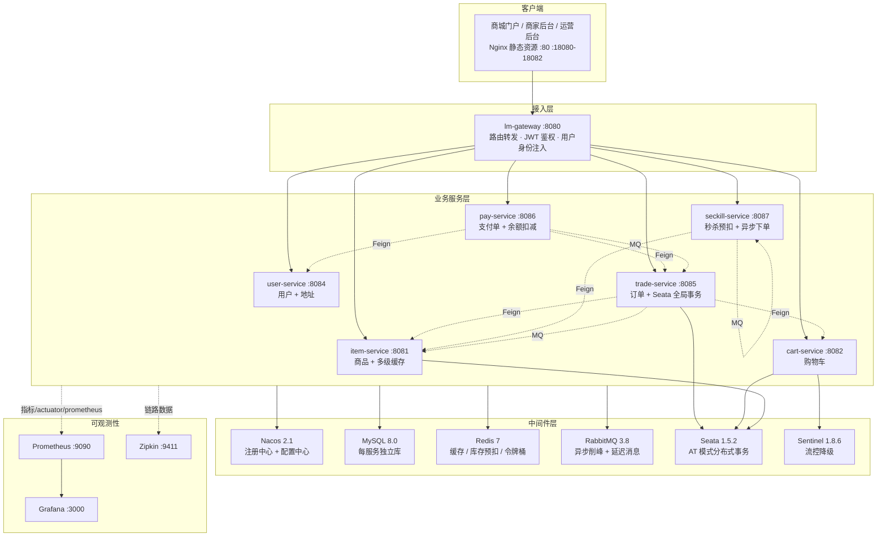
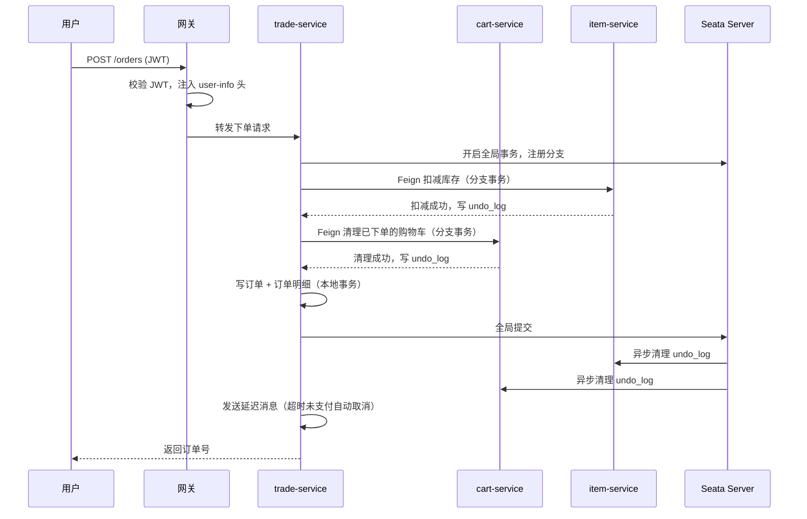
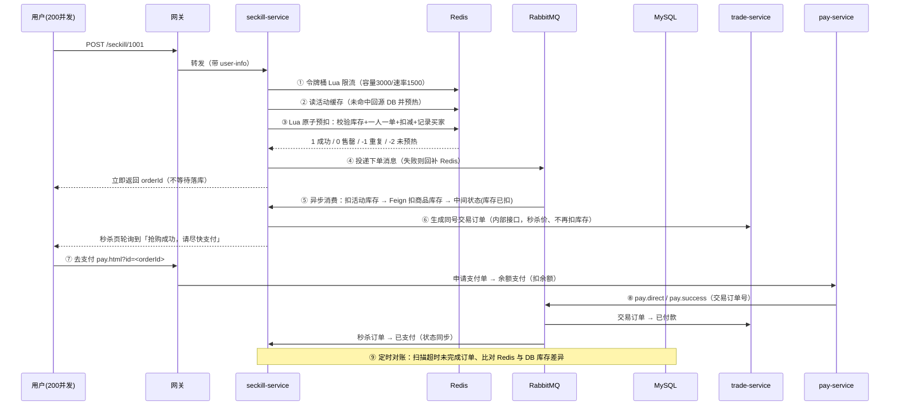
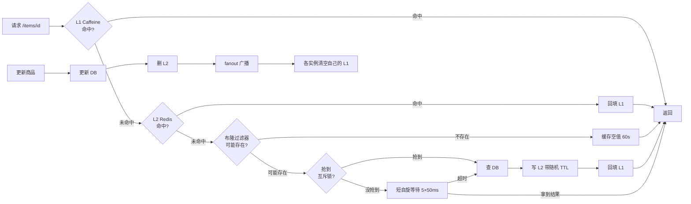

# LimeMall 架构文档

> 本文档描述「青柠商城 LimeMall」的整体架构、关键链路设计、技术选型与取舍。
> 所有链路都在本机真实跑通并验证过（验证方式见各章节末）。

## 一、系统概览

LimeMall 是一套基于 Spring Cloud Alibaba 的电商微服务系统，覆盖**用户、商品、搜索、购物车、交易、支付、秒杀**七条业务链路。

## 二、服务清单

| 模块 | 端口 | 管理端口 | 职责 | 数据库 | 关键依赖 |
|---|---|---|---|---|---|
| `lm-gateway` | 8080 | 9080 | 统一入口、路由、JWT 校验、用户身份注入 | — | Nacos、JKS 密钥库 |
| `item-service` | 8081 | 9081 | 商品 CRUD、分页、多级缓存 | `lm_item` | Redis、RabbitMQ、Seata |
| `cart-service` | 8082 | 9082 | 购物车增删改查 | `lm_cart` | Seata、Sentinel |
| `user-service` | 8084 | 9084 | 登录发 token、用户、地址 | `lm_user` | Nacos |
| `trade-service` | 8085 | 9085 | 下单、订单查询、状态流转 | `lm_trade` | Seata、RabbitMQ |
| `pay-service` | 8086 | 9086 | 支付单、余额支付、MQ 通知 | `lm_pay` | RabbitMQ |
| `seckill-service` | 8087 | 9087 | 秒杀预扣、限流、异步下单、对账 | `lm_seckill` | Redis、RabbitMQ |
| `lm-common` / `lm-api` | — | — | 公共组件（异常、工具、拦截器）/ 服务契约（Feign 接口 + DTO） | — | — |
| `lm-shop` | 8080 | 9089 | 单体基线版本（用于对比微服务改造，与网关互斥启动） | `limemall` | — |

## 三、关键链路设计

### 3.1 下单链路（Feign + Seata AT 全局事务）

**为什么用 Seata AT**：下单要跨库存、购物车、订单三个库，任一失败必须整体回滚。AT 模式对业务代码无侵入（只需 `@GlobalTransactional`），本地事务 + undo_log 反向补偿即可，比 TCC 少写两套接口、比消息最终一致少一套可靠消息表。

**取舍**：秒杀链路**故意不用 Seata**——秒杀追求高吞吐，全局事务会带来额外开销和锁等待，改用「Redis 预扣 + MQ 异步 + 对账补偿」的最终一致性方案（见 3.2）。

### 3.2 秒杀链路（本项目核心亮点）

**秒杀订单与交易订单的关系**：两者用**同一个订单号**。秒杀服务在预扣时就生成雪花 id，
落库后带着这个 id 调交易服务的内部接口建单，因此用户凭页面上的订单号即可走正常支付流程，
不需要额外的映射表；支付成功消息同时被交易服务与秒杀服务消费，各自更新自己库里的状态。

**四道防线（按面试常问的顺序）**：

| 风险 | 手段 | 说明 |
|---|---|---|
| 超卖 | Redis + Lua 原子预扣 | 「查库存 + 查重复 + 扣减 + 记录买家」四步合成一次原子操作，Redis 单线程执行天然串行 |
| 重复下单 | Set 去重 + DB 唯一索引 | Redis 挡住绝大多数，DB `uk_activity_user` 兜底，消费端捕获冲突后回补 |
| 瞬时流量打垮下游 | 令牌桶限流 + MQ 削峰 | 请求进来先过桶；下单只写 MQ，数据库按自己节奏消费 |
| 补偿重入重复扣库存 | 中间状态 `STATUS_STOCK_DEDUCTED` | 库存扣减只执行一次，重试/对账补建交易订单时跳过扣减步骤 |
| 抢到之后无处支付 | 落库后生成**同号**交易订单 | 秒杀绕过购物车直接成单，用户凭订单号走正常支付流程（已实测闭环） |
| 状态各自为政 | 监听支付成功消息双向同步 | `pay.direct`/`pay.success` 同时被交易服务与秒杀服务消费 |
| 数据最终一致 | 定时对账 + 补偿 | 超时未完成订单回补库存、Redis 与 DB 库存差异超阈值告警 |

**实测**：200 用户抢 100 件 → **恰好 100 单、零超卖**，吞吐 105 TPS / 平均 1,442ms；
对照的「DB 悲观锁 + 同步扣库存」实现为 43.5 TPS / 3,472ms（详见 [压测报告](load-test-report.md)）。

### 3.3 商品详情多级缓存

| 问题 | 手段 |
|---|---|
| 缓存穿透 | Redis 位图布隆过滤器（16M bit / 4 个哈希）拦截不存在的 id；误判时用空值缓存兜底 |
| 缓存击穿 | `SETNX` 互斥锁只放一个线程回源，其余短自旋；极端情况退化为直接查库保证可用性 |
| 缓存雪崩 | L2 过期时间加 0~60s 随机抖动；L1 短 TTL（30s）吸收热点读 |
| 多实例 L1 不一致 | 更新后通过 fanout 交换机广播，每个实例一个匿名队列，各自清理本地缓存 |

**实测**：50 并发 30 秒，走缓存 **13,383 TPS / 平均 3.4ms**，直连 DB 2,689 TPS / 17.1ms（约 5 倍）；
40 万次请求只回源数据库 3 次；缓存失效瞬间 60 并发只有 1 次回源（`infra/tools/cache-bench.ps1` 验证）。

## 四、技术选型与取舍

| 选择 | 理由 | 放弃了什么 |
|---|---|---|
| Spring Cloud Alibaba（Nacos + Sentinel + Seata） | 组件齐全，注册/配置/流控/事务一套打通，中文资料多 | 相比 K8s 原生服务发现更"重" |
| Nacos 做配置中心 | 支持动态刷新，本地开发改配置不用重启 | 配置变更缺少审批流（生产建议加） |
| Seata AT | 对业务无侵入，能覆盖下单跨库场景 | 有全局锁开销，秒杀链路刻意不用 |
| Redis + Lua | 单线程原子执行，避免"先查后改"的并发窗口 | Lua 脚本调试不如 Java 方便 |
| RabbitMQ | 支持延迟消息（超时未支付取消），生态成熟 | 相比 Kafka 吞吐低，但本项目量级足够 |
| Caffeine + Redis 两级缓存 | L1 挡热点（纳秒级），L2 做共享层 | 需要处理多实例 L1 一致性（已用广播解决） |
| Sleuth + Zipkin（而非 SkyWalking） | 与 Spring Cloud 原生集成、零探针、起一个容器即可 | 功能不如 SkyWalking 全（无拓扑图/告警联动） |
| 管理端口与业务端口分离 | Actuator 不暴露在业务端口，更安全；同时绕开 springfox 兼容问题 | 端口数量翻倍（用「业务端口+1000」规则统一） |

## 五、数据模型

| 库 | 表 | 说明 |
|---|---|---|
| `lm_item` | `item`、`undo_log` | 商品（24 条种子数据），库存扣减用 `stock >= num` 条件更新防超卖 |
| `lm_cart` | `cart`、`undo_log` | 购物车 |
| `lm_trade` | `order`、`order_detail`、`order_logistics`、`undo_log` | 订单主表/明细/物流 |
| `lm_user` | `user`、`address` | 用户（BCrypt 密码）、地址 |
| `lm_pay` | `pay_order` | 支付单 |
| `lm_seckill` | `seckill_activity`、`seckill_order` | 活动（含库存/时间窗）、秒杀订单（`uk_activity_user` 唯一索引兜底一人一单） |
| `nacos` | 12 张表 | 配置中心自带 |

**约定**：金额一律用 `int` 存**分**；主键用雪花 ID；每张业务表带 `create_time` / `update_time`。

## 六、部署拓扑

单机 Docker Compose（`infra/docker-compose.yml`，项目名 `lm-infra`）：

| 容器 | 端口 | 用途 |
|---|---|---|
| lm-mysql | 3306 | 业务库 + Nacos 配置库 |
| lm-nacos | 8848 / 9848 / 9849 | 注册与配置中心 |
| lm-mq | 5672 / 15672 | 消息队列（自定义镜像带延迟插件） |
| lm-redis | 6381 → 6379 | 缓存 / 秒杀库存 / 令牌桶 |
| lm-seata | 8091 / 7091 | 分布式事务协调器 |
| lm-sentinel | 8090 | 流控控制台 |
| lm-nginx | 80 / 18080-18082 | 前端静态资源 + `/api` 反代 |
| lm-prometheus | 9090 | 指标抓取与告警规则 |
| lm-grafana | 3000 | 监控面板 |
| lm-zipkin | 9411 | 链路追踪 |

7 个业务服务以 JVM 进程运行在宿主机（`infra/start-all.ps1` 一键启动，堆上限 `-Xmx512m`）。

## 七、验证方式（每个阶段都留了可复现的验证脚本）

| 验证项 | 脚本 / 命令 | 通过标准 |
|---|---|---|
| 秒杀防超卖 | `infra/tools/seckill-concurrency-check.ps1 -Users 60 -Stock 20` | 订单数 = 库存数，Redis 与 DB 库存一致，买家数 = 库存数 |
| 多级缓存 | `infra/tools/cache-bench.ps1` | 缓存读比直连 DB 快数倍；穿透 0 回源；击穿仅 1 次回源；跨实例更新立即可见 |
| 压测 | `infra/jmeter/*.jmx` + `infra/tools/jmeter-report.ps1` | 输出吞吐/延迟分位/错误率对比表 |
| 指标与告警 | `curl localhost:9090/api/v1/rules` | 7 条规则状态可见，异常时 firing |
| 链路追踪 | `curl "localhost:9411/api/v2/traces?serviceName=gateway&limit=5"` | 一次下单可见 20+ span 的跨服务调用树 |
